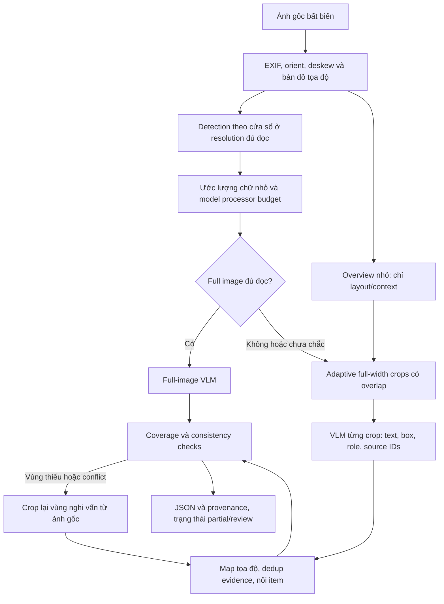

# Đánh giá USER_PROMPT_TEMPLATE và hóa đơn dài

Ngày đánh giá: 2026-09-09. Phạm vi: mã nguồn và cấu hình trong workspace,
kiểm thử CPU với ảnh tổng hợp; chưa có phép đo OCR/VLM trên ảnh lỗi có ground truth.
Cấu hình file không chứng minh cấu hình container đang chạy.

## Kết luận và bằng chứng trong repository

Prompt có lỗi diễn đạt và heuristic quá mạnh, nhưng nút thắt của ảnh dài là
mất thông tin trước vision encoder. Cần giải quyết cả detection, ảnh VLM và
reconstruction; tăng khả năng suy luận không tái tạo được ký tự đã mất pixel.

| Ưu tiên | Phát hiện | Bằng chứng / ảnh hưởng |
|---|---|---|
| P0 | Chưa có inference theo tile độc lập | `processing._run_pipeline_stages` gửi các ảnh đã fit vào một lần `extract_receipt_with_llm`. Không có planner/coordinate merge/item stitcher. |
| P0 | Detector cũng thu nhỏ toàn ảnh dài | `ServicesConfig`: `det_limit_side_len=1920`, `det_limit_type=max`; `PaddleTextDetector.detect` gọi trên toàn ảnh. Với ảnh 1500×12000, scale lý tưởng 0.16 làm dòng 24px còn 3.84px trước alignment của detector. Detection có thể bỏ sót cả vùng dù nguồn rõ. |
| P0 | Trần cạnh làm mất chữ ngay ở client | `FitConfig.max_side=3584`; solver lấy min giữa trần cạnh và trần diện tích. 1500×12000, dòng 24px → scale 0.2987 → ảnh khoảng 448×3584, dòng khoảng 7.17px. Đây là kết quả tính toán, không phải benchmark accuracy. |
| P1 | Cờ legibility trước bản sửa không phản ánh downscale khi zoom OFF | `_plan_for_dims` yêu cầu `zoom=True` mới bật `legibility_capped`; mặc định zoom target = 0. |
| P1 | Metadata API trước bản sửa chỉ kiểm tra chiều cao chữ nguồn | `_build_image_quality` dùng `median_text_height_px`, không dùng `text_h_at_output_px`. Nguồn tốt nhưng ảnh VLM xấu có thể không được cảnh báo. |
| P1 | Fallback cũng mất resolution và context | Trước bản sửa, purpose `FALLBACK_OCR` vẫn chạy trần diện tích/cạnh của `FitStage`. Sau đó Paddle có trần detector riêng; `paddle_text` còn cap số dòng và `text_extractor._build_fitted_prompt` cắt đuôi khi thiếu context. |
| P1 | Partial extraction dễ bị coi là thành công | `_has_substantive_data`: chỉ cần một scalar hoặc một item. Đọc được cửa hàng nhưng bỏ hết items không kích hoạt `empty_response`; một vài items cũng không chứng minh coverage đầy đủ. |
| P1 | Budget primary thiếu visual tokens | `_compute_max_tokens` trừ text + margin, chưa trừ image tokens. Hai ảnh tối đa 3072 visual tokens/ảnh có thể vượt context 12288 khi cộng prompt/output. Cần tính bằng processor/chat template cùng phiên bản server. |
| P1 | Schema chưa chứa promotion/original_price/provenance | `ReceiptItem` chỉ có name, quantity, price, total; prompt hiện bỏ metadata giảm giá/giá gốc. Không thể đáp ứng hợp đồng 6 field bằng prompt đơn thuần. |
| P2 | Reflow không phải tiled inference | `compose_columns` ghép mọi phần vào một canvas, gần bảo toàn diện tích, vẫn dùng chung visual budget. Whitespace giữa hai dòng không đảm bảo là ranh giới item. Mặc định reflow OFF. |
| P2 | Tài liệu prompt cũ lệch implementation | `docs/prompt_design.md` còn mô tả field đã bỏ, năm hiện tại, 5 loại layout và các khẳng định hiệu quả chưa có benchmark tương ứng. Không dùng làm đặc tả runtime hiện tại. |

Gate có thể đánh `UNREADABLE` khi detection thiếu, hoặc text dự đoán nhỏ kèm blur thấp.
Tuy nhiên `compat.preprocess_image_with_meta` vẫn trả ảnh và API vẫn inference;
không kết luận gate là nguyên nhân trực tiếp làm API từ chối ảnh ở luồng này.
Digital route bỏ detection nên thiếu phép đo text height; không được xem
`text_height=None` là bằng chứng chữ đủ lớn.

## Đánh giá prompt và sửa cục bộ đã thực hiện

| Quy tắc cũ | Vấn đề | Hành vi sau sửa |
|---|---|---|
| `never infer` | Có thể cấm cả reasoning cần thiết để nối dòng | Cho phép suy luận liên kết text in sẵn; cấm bịa ký tự/tính field thiếu. |
| Item chỉ có một số tiền → luôn `t` | Có thể thực ra là đơn giá, đặc biệt app card có `×N` | Ưu tiên nhãn/cột; mơ hồ → null field tương ứng, giữ tên. |
| Multi-row chủ yếu name + numeric line | Thiếu nguyên tắc tổng quát cho 2–4+ dòng | Dùng anchor, reading order, indentation, khoảng cách, alignment và ranh giới item/summary. |
| `it MUST NOT be empty`, mỗi app item phải có `t` | Ép output khi thiếu bằng chứng, mâu thuẫn null discipline | Emit theo evidence; không ép non-empty/total. |
| Không có logo → null cả tên lẫn địa chỉ | Xóa địa chỉ đọc được | Tách evidence cho từng field. |
| Grand total yêu cầu nhãn cùng dòng | Mất total có nhãn xuống dòng | Cho phép dòng kề/cột cùng summary block có liên kết rõ. |
| Quantity thập phân chỉ khi không có unit price | Sai cho hàng cân có đủ qty, unit price, total | Dùng unit/column để phân biệt lượng thập phân với tiền. |
| Số lớn cuối item mặc nhiên là giá gốc | Dạy model đoán nghĩa theo độ lớn | Example có nhãn giá gốc tường minh. |
| Reject future dates nhưng không cấp ngày tham chiếu | Model phải tự giả định thời gian | Chỉ loại ngày không hợp lệ/không phải ngày giao dịch; giữ ngày giao dịch đọc rõ. |
| Reflow chỉ hướng dẫn đọc cột | Có thể tách item tại chân cột | Cho phép continuation sang đầu cột sau. |

Giữ API schema hiện tại. Chưa thay chính sách loại quà tặng/refund/add-on trong
postprocessor; đây là các quyết định nghiệp vụ cần đưa vào benchmark. Cụ thể,
prompt vẫn bỏ khuyến mãi/giá gốc khỏi JSON hiện tại; muốn giữ phải mở rộng schema
nội bộ và cập nhật cả vision prompt, text prompt, validators, postprocessor.
Text-only prompt chưa đồng bộ toàn bộ heuristic trong bản sửa này.
Không tuyên bố prompt ngắn hơn sẽ luôn tốt hơn, hay tăng temperature sẽ sửa OCR.

Các sửa preprocessing đã thực hiện:

- Thêm `PP2_FIT_MIN_TEXT_HEIGHT_PX` (default 16): ngưỡng cảnh báo độc lập với zoom.
  Đây là chiều cao **text polygon**, chưa phải chiều cao glyph. Cần calibrate.
- Fit đo mức giữ chi tiết theo scale nhỏ hơn giữa hai trục, tránh padding/alignment
  làm metric lạc quan. Đây là proxy bảo thủ, không phải OCR confidence.
- API thêm `text_h_at_output_px`, `output_low_legibility`, `legibility_capped` và
  warning `VLM RESOLUTION RISK`. Giữ semantics của `low_legibility` cũ (ảnh nguồn).
  Thiếu phép đo → null cho kết luận cần phép đo; có một ảnh yếu → cảnh báo.
  Metadata chỉ phản ánh fit phía client, chưa đo processor thật bên server.
- Fallback bỏ bước fit vào trần VLM, giữ pixels sau orient/crop. Paddle vẫn có
  resize riêng, do đó thay đổi này chưa giải quyết hoàn toàn ảnh dài. Ảnh lớn
  làm tăng RAM/encode/transfer ở fallback; phải đo với giới hạn decode hiện có.

Các phần bên dưới là thiết kế đề xuất, **chưa được tích hợp vào runtime**.

Kiểm chứng bản sửa: 91 tests passed (83 preprocessing tests có sẵn trong thư mục
local `tests/` đang bị gitignore, 8 regressions mới lưu tại
`src/preprocessing/eval/test_resolution_regressions.py`). Kiểm tra syntax toàn
`src/`, render prompt thường/reflow và diff whitespace đều đạt. Lệnh chạy:

```bash
python -m pytest tests/preprocessing src/preprocessing/eval/test_resolution_regressions.py -q
# Chạy riêng regressions mà không cần pytest:
python -m unittest src.preprocessing.eval.test_resolution_regressions
```

Chưa deploy/restart server, chưa chạy inference benchmark trên GPU; những tests
này không chứng minh prompt mới tăng field accuracy hoặc xử lý đủ mọi ảnh dài.

## Kiến trúc production đề xuất



Overview có thể dùng CV/layout detector; không bắt buộc gọi thêm VLM cho mọi hóa
đơn. Nếu dùng global VLM, chỉ lấy vùng/column semantics, không lấy số tiền/chữ nhỏ
làm ground truth. Không được chỉ đọc những vùng global nhìn thấy: crop chi tiết
phải bao phủ toàn bộ nội dung để global miss không trở thành miss vĩnh viễn.
Không gửi overview lặp trong mọi tile nếu compact context đã đủ.

## Preprocessing và công thức resize/tile

1. Decode có giới hạn pixel; lưu hash ảnh gốc và trang. EXIF/orient/deskew có
   transform đầy đủ. Không crop nội dung theo detector global có coverage thấp.
2. Detection thăm dò theo cửa sổ full-width có overlap từ ảnh gốc/oriented.
   Nếu detector cũng downscale quá mạnh, giảm chiều cao cửa sổ trước predict.
   Gộp boxes về frame chung. Digital receipt cũng cần probe khi dài/chữ nhỏ.
3. Ước lượng `h_small = P10/P20` chiều cao dòng chữ, bỏ logo/barcode/noise; dùng
   phân vị theo từng vùng và chiều rộng ký tự nếu có recognition. Median toàn
   trang dễ che chữ giá/khuyến mãi nhỏ. Polygon có thể nở hơn glyph.
4. Dùng chính image processor đã pin phiên bản để dự đoán grid/output size.
   Kiểm tra sau crop, padding, alignment, min_pixels và cả resize bên vLLM.
5. Full-image chỉ khi chiều cao **và** chiều rộng ký tự dự kiến còn đạt ngưỡng,
   coverage detector đáng tin và input+output fit context. Aspect ratio thấp
   không được miễn kiểm tra: hóa đơn vuông nhiều chữ nhỏ cũng cần tiling.
6. Không đủ điều kiện → tiling từ ảnh nguồn trước global downscale. Không crop
   từ ảnh đã thu nhỏ rồi upscale lại. Không có text measurement → probe thêm;
   với ảnh dài, chọn conservative tiling thay vì mặc định readable.

Xấp xỉ ban đầu (bỏ qua alignment):

```text
s_full = min(1, max_side/max(W,H), sqrt(P_eff/(W*H)))
h_out  = h_small * s_full
w_out  = char_width_small * s_full  # nếu đo được
P_eff  = min(pixel_cap, visual_token_cap * (patch_size*merge_size)^2)
T_text + T_visual + T_output_reserve + T_template_margin <= max_model_len
full_ok = h_out >= h_min AND w_out >= w_min AND context_ok
```

Nếu không đo được character width, dùng conservative text-height proxy đã
calibrate và đánh dấu uncertainty, không giả lập một phép đo có thật. Ngưỡng
khởi điểm cho **glyph** 16–24px chỉ là dải thử nghiệm, không bảo đảm cho mọi
font/model. Tránh áp trực tiếp cùng ngưỡng lên polygon DBNet.

## Thuật toán tile và overlap

Giữ toàn bộ chiều rộng receipt để bảo toàn cột name/qty/prices. Chọn scale
`<=1` lớn nhất phù hợp chi phí nhưng đủ giữ chữ nhỏ; nếu chữ nguồn đã dưới target,
upscale chỉ là thử nghiệm cải thiện sampling, không bảo đảm tạo thêm thông tin.
Với scale `s` đã chọn:

```text
H_tile <= min(max_side/s, P_eff/(W*s*s), preferred_height)
W*s <= max_side
O = max(0.15*H_tile, estimated_item_height_P95 + boundary_margin)
stride = H_tile - O
```

Khởi đầu thử tile cao 1536–3072 pixel nguồn và overlap 15–25%, rồi điều chỉnh
theo `s` và kích thước item; không chọn kích thước cố định cho mọi DPI. Nếu
full-width không thể giữ chữ đủ lớn dưới width cap, dùng cột/semantic regions
có liên kết cột hoặc detector/recognizer line crops; không cứ thu nhỏ width.

Chọn đường cắt gần mục tiêu tại whitespace, ưu tiên gap giữa item blocks đã
nhận diện. Gap giữa hai text lines chỉ đảm bảo không cắt nét chữ, chưa đảm bảo
không cắt item. Sliding window là fallback đáng tin khi segmentation yếu.
Luôn lưu phần fragment ở mép tile, kể cả chưa có tên sản phẩm.

Với fixed window cao H, overlap O, nếu **mọi item có span <= O** thì mọi item
nằm trọn trong ít nhất một cửa sổ (với coverage đầy đủ đầu/cuối trang). P95 chỉ
bao phủ đa số, không bảo đảm tuyệt đối. Item dài hơn O, semantic boundary bất
định hoặc O >= H → mở rộng crop/retry block, không chỉ clamp overlap rồi coi
là đã an toàn. Planner phải bảo đảm stride > 0, covered interval liên tục và
không mất đuôi trang.

Ví dụ tính toán: 1500×12000, dòng nguồn 24px, s≈0.8, crop 1500×2560, overlap
512, stride 2048 → khoảng 6 crops. Ảnh mỗi crop khoảng 1200×2048 trước alignment,
dòng ~19.2px thay vì ~7.2px. Đây vẫn là ngưỡng proxy cần test, không cam kết OCR.
Chi phí lặp vùng xấp xỉ `1/(1-overlap_ratio)`: 20% → 1.25×, 30% → 1.43×.
Không ghép lại tất cả tile thành một ảnh; làm vậy lại dùng chung pixel budget.

## Tọa độ và schema evidence

Mỗi tile lưu `document_id`, `page_id`, `tile_id`, bbox trong frame chuẩn,
`core_bbox`, `source_size`, `processed_size`, `scale_x/y`, `pad_left/top`,
processor/model version và ma trận original→canonical. Không chỉ lưu một `scale`.

```text
x_canonical = (x_model - pad_left) / scale_x + crop_x1
y_canonical = (y_model - pad_top)  / scale_y + crop_y1
p_original  = inverse(T_original_to_canonical) * p_canonical
```

Nếu bbox model là normalized 0..1000, đổi về pixel canvas trước. Transform cả
4 đỉnh rồi mới lấy enclosing box; rotation/perspective không thể map đúng chỉ
bằng cộng y-offset. Reflow cần map riêng từng segment; khuyến nghị không dùng
reflow ở pipeline tiled. Phép resize thứ hai của server phải nằm trong transform.

Evidence nội bộ nên gồm:

```json
{
  "id": "page0-tile3-line7",
  "text": "KHUYẾN MÃI -6.000",
  "polygon_original": [[0,0],[1,0],[1,1],[0,1]],
  "role": "item_discount",
  "tile_id": 3,
  "truncated_top": false,
  "truncated_bottom": false,
  "ocr_confidence": null,
  "alternatives": []
}
```

Tọa độ ở example chỉ minh họa schema. VLM tự khai confidence không phải xác suất
đã calibrate; ưu tiên detector geometry và OCR confidence thực nếu có. Có thể
cấp stable line IDs/boxes từ OCR rồi yêu cầu VLM trả association bằng IDs để tránh
phụ thuộc hoàn toàn vào bbox do VLM đoán.

## Merge overlap và reconstruct item

Dedup **evidence trước**, assemble item sau:

1. Chỉ tìm candidate cùng document/page, khác tile và nằm trong vùng overlap thật.
2. Spatial gate: IoU ban đầu 0.5 hoặc intersection/min-area cao cho fragment,
   center distance trong khoảng ~0.5–1 chiều cao dòng; tune với bbox detector.
3. Text similarity sau Unicode/whitespace normalization, ví dụ 0.9; giữ nguyên
   raw text, dấu âm, dấu thập phân và digits. Embedding chỉ hỗ trợ candidate
   name/continuation, không đủ để gộp hai amount khác nhau.
4. Match một-một giữa hai tập evidence. Ưu tiên box ở giữa crop, đầy đủ nét,
   recognition confidence tốt; merge provenance. Hai lần mua cùng tên/giá ở
   y khác nhau phải giữ cả hai. Text cùng nhau mà vị trí khác không phải duplicate.
5. Cùng vị trí nhưng số tiền khác → conflict, giữ alternatives và crop lại vùng
   đó; không chọn số “hợp tổng” để thay evidence. Tránh union-find bắc cầu gộp
   nhiều dòng gần nhau chỉ qua similarity trung gian.

Item reconstruction dùng graph có thứ tự hoặc sequence labeling/beam search:

- Node = text/field evidence, role = name, name_continuation, qty, unit_price,
  original_price, item_discount, line_total, metadata, summary.
- Edge score gồm reading order, vertical gap/line height, indentation, cột số
  căn phải, cùng block, pattern `SL`, `N x price`, barcode và lexical name.
- Name anchor mở item; wrapped name/pack-size nối tên; metadata không làm đóng
  item; anchor mới/summary separator thường đóng item. Phân biệt chữ trong tên
  `4x180`, `330ML` với lượng thực mua; không group chỉ bằng Y.
- Ràng buộc: evidence field thuộc tối đa một item; item không băng qua summary;
  không nhảy qua anchor mạnh khác; không gắn promotion toàn hóa đơn vào item.
  Original price phải lưu basis `per_unit`/`line`/`unknown`, discount lưu scope
  `item`/`receipt`, loại `amount`/`percent` và dấu in thật.
- Giữ open fragments tại biên. Nếu tile A có tên, tile B có SL/giá, dùng global
  positions + shared overlap lines nối vào cùng anchor; thiếu evidence → recrop
  hợp vùng biên từ nguồn, tăng window theo budget. Không drop orphan sớm.
- Arithmetic chỉ check consistency (discount, rounding, weighted goods, tax),
  không sửa giá in để ép `qty*unit_price=total`.

Tách schema nội bộ đầy đủ với `source_ids` từng field khỏi serializer API cũ.
Để đáp ứng 6 field, thêm `original_price`/`promotion` và scope/basis trong schema
version mới, hoặc giữ chúng ở evidence trước khi client sẵn sàng nâng version.
Không thể đo reconstruction đủ 6 field chỉ từ response hiện tại.

## Visual tokens, GPU và batching

Với grid patch p: `N_patch≈ceil(W/p)*ceil(H/p)`. Sau spatial merge m×m,
`N_visual≈N_patch/m²`; số token thực phải lấy theo image grid của processor.
Không áp một công thức chung cho model có resampler/query pooling khác.

| Ảnh 896×1792 | Patch encoder | Merge | Patch tokens | Visual tokens đưa vào LLM |
|---|---:|---:|---:|---:|
| Giả định không merge | 14 | 1 | 8192 | 8192 |
| Giả định không merge | 16 | 1 | 6272 | 6272 |
| Giả định không merge | 28 | 1 | 2048 | 2048 |
| Qwen3-VL, ảnh tĩnh | 16 | 2 | 6272 | khoảng 1568 |

Qwen3-VL khai `patch_size=16`, `merge_size=2`, `temporal_patch_size=2` trong
[processor config chính thức](https://huggingface.co/Qwen/Qwen3-VL-8B-Instruct/blob/main/preprocessor_config.json).
Cần đối chiếu đúng processor revision của checkpoint FP8 đang deploy. 28×28
có thể là effective stride patch14×merge2 ở model khác, không nhất thiết là patch
encoder gốc. Temporal packing ảnh tĩnh không có nghĩa tự nhân đôi visual tokens.

Tăng cả hai cạnh 2× → diện tích/patch tokens ~4×. Vision activation và prefill
cost tăng; attention cost còn tùy kiến trúc/windowing/kernel. Với decoder chuẩn,
KV xấp xỉ `2*layers*kv_heads*head_dim*bytes_per_element*sequence_length` mỗi
sequence (chưa tính block allocator, sharding và buffer). Visual tokens trong
prompt cũng chiếm sequence/KV; tile nhiều request giảm peak context từng request,
nhưng tăng tổng tokens/prefill và công việc theo receipt.

Compose hiện khai `max_num_seqs=16`, `max_num_batched_tokens=8192`,
`max_model_len=12288`, GPU utilization 0.7, FP8 KV, image limit 2/request.
Giữ đây là baseline để đo, không tự tăng utilization: Paddle dùng chung GPU.

- Mỗi tile là một request (thường một ảnh), không nhét 10–50 ảnh vào một prompt.
  [vLLM hỗ trợ image inputs](https://docs.vllm.ai/en/stable/features/multimodal_inputs/);
  giới hạn ảnh của deployment phải tương thích request.
- Queue chung nhiều receipt, bounded concurrency/token-weighted admission;
  bắt đầu đo 2–4 tile đang chạy mỗi receipt, có global cap và fairness.
  Semaphore receipt hiện có không đủ nếu mỗi receipt fan-out 50 request.
- Bucket theo predicted input tokens/output size; server continuous batching
  tự phối hợp các request. `max_num_batched_tokens` là scheduler token budget
  mỗi iteration, không phải tổng token trọn đời batch hay pixel cap từng ảnh.
- `max_num_seqs` chặn active sequences; chunked prefill chia prefill theo lịch,
  không phục hồi chữ bị resize. Theo dõi TTFT, decode latency, queue wait,
  preemption, encoder peak memory và KV usage khi tuning. Đây là các cơ chế
  được mô tả trong [tài liệu tuning vLLM](https://docs.vllm.ai/en/stable/configuration/optimization/).
- Nếu input/output không fit: giảm semantic window hoặc chia mapping theo item
  groups. Không trim tail OCR im lặng; retry phần thiếu. Không dùng output floor
  để ép gửi request vốn đã overflow.
- Cache theo hash nguồn+bbox+processor+prompt+schema version; retry đúng tile lỗi,
  idempotent aggregation, cancellation cho mọi child request. Không bật unlimited
  `asyncio.gather`. Giới hạn tile/work/receipt; vượt budget trả partial có lý do
  hoặc đưa hàng đợi chậm, không giả vờ đã đọc đủ.

## Pseudo-code toàn pipeline (thiết kế, không phải code runtime)

```python
async def process_receipt(raw, cfg, deps):
    source = deps.decoder.decode_immutable(raw)
    page, original_to_page = deps.geometry.canonicalize(source)
    # Detection must itself use windows that retain sufficient resolution.
    lines = await deps.detector.detect_windowed(page, cfg.detector_budget)
    measurement = deps.legibility.measure_per_region(page, lines)
    full = deps.processor.plan_exact(page.size, cfg.model_revision)
    enough_detail = measurement.is_known and measurement.survives(full)
    enough_context = deps.budget.fits(full, cfg.prompt, cfg.output_reserve)

    if enough_detail and enough_context:
        evidence = await deps.reader.read_full(page, full, lines)
    else:
        # Overview supplies layout only; never limits high-resolution coverage.
        layout = await deps.layout.overview(page, lines)
        tiles = deps.planner.cover_full_page(
            page, lines, measurement, layout,
            overlap_from_item_spans=True,
            fallback_to_sliding_windows=True,
        )
        deps.planner.assert_coverage_and_budget(tiles)
        async def read_tile(tile):
            crop = deps.geometry.crop_from_source(page, tile)
            prepared, transform = deps.processor.prepare(crop)
            budget = await deps.budget.count_multimodal_request(
                prepared, deps.prompts.local(layout, tile),
            )
            budget.require_output_reserve()  # split/requeue if insufficient
            async with deps.admission.reserve(budget, receipt_id=source.id):
                local = await deps.reader.read_evidence(prepared, tile, lines)
            return deps.geometry.to_original(local, transform, tile,
                                             original_to_page)
        evidence = await deps.queue.map_bounded(read_tile, tiles)

    evidence = deps.deduper.match_overlap_only(evidence)
    items = deps.items.reconstruct(evidence, allow_open_fragments=True)
    for attempt in range(cfg.max_targeted_retries):
        gaps = deps.validator.find_gaps_conflicts_and_open_items(lines, evidence, items)
        if not gaps:
            break
        # Recrop source, never upscale the already downsampled VLM image.
        repairs = await deps.reader.read_targeted_regions(page, gaps)
        evidence = deps.deduper.merge_with_provenance(evidence, repairs)
        items = deps.items.reconstruct(evidence, allow_open_fragments=True)
    quality = deps.validator.finalize(lines, evidence, items)
    return deps.serializer.receipt(items, evidence, quality,
                                   partial=quality.has_unresolved_regions)
```

Không dùng prediction-only confidence để quyết định full path; uncertainty và
coverage thiếu cũng phải dẫn tới probe/crop. Với receipt nhiều trang, tất cả
helpers phải giữ page_id; fallback hiện chỉ dùng `raw_bytes_list[0]` cần sửa khi
đưa kiến trúc mới vào để không mất các trang sau.

## Module/class đề xuất và thứ tự triển khai

| Module mới / điểm mở rộng | Trách nhiệm |
|---|---|
| `preprocessing/model_budget.py` | ProcessorAdapter: grid, resolution, visual/context budget đúng revision |
| `preprocessing/tiling.py` | TilePlanner: full coverage, overlap, safe split, core ownership |
| `preprocessing/transforms.py` | TransformChain: original/canonical/crop/model coordinates |
| `preprocessing/detectors.py` | WindowedTextDetector, local text-size evidence, không global-only resize |
| `schemas/evidence.py` | TextEvidence, FieldEvidence, ItemFragment, provenance và conflicts |
| `extraction/tile_extractor.py` | Prompt local + schema evidence + request budget |
| `extraction/tile_merge.py` | Spatial dedup một-một, giữ alternatives |
| `extraction/item_reconstructor.py` | Item graph/sequence constraints, boundary repair |
| `extraction/tile_scheduler.py` | Admission theo token, fairness, retries/cancellation |
| `preprocessing/eval/` | Geometry invariants và benchmark OCR/field/grouping |

Triển khai theo giai đoạn: (1) chốt GT/evidence contract, processor budget và
transform; (2) windowed detector + sliding overlap + local reader + dedup;
(3) item reconstruction/repair/coverage trước khi bật production; (4) adaptive
semantic segmentation và throughput tuning. Rollout feature flag theo aspect
bucket, lưu baseline, canary rồi mới mở rộng. Full path vẫn phục vụ ảnh đủ đọc.

## Benchmark và tham số cần tuning

So sánh A full resize, B fixed no-overlap, C fixed overlap, D OCR-guided overlap,
E global+local hierarchical. Thêm ablation prompt cũ/mới trên cùng preprocessing
để tách lợi ích prompt khỏi lợi ích pixels. Cùng checkpoint, sampling, schema và
postprocessor; đo cả cùng cost budget lẫn best achievable quality.

GT gồm Unicode text, polygon, reading order, item_id từng dòng, 6 field/item,
header/footer presence, vùng cố ý mờ/crop và promotion scope. Split theo merchant
layout/template/source để tránh leakage. Bucket aspect <2, 2–4, 4–8, >8; thêm
DPI/chữ nhỏ, số item, ảnh chụp/digital, số dòng/item. Bắt đầu 200–500 ảnh gán nhãn,
mở rộng hard set và holdout; số này là kế hoạch, chưa phải bộ đã có.

- CER=(S+D+I)/N_char; WER tương tự. Nếu công bố character/word accuracy thì ghi
  rõ `1-CER`, `1-WER` có thể âm khi insertion nhiều; không che bằng clamp.
- Field exact accuracy sau normalization đã chốt; ghi missing/incorrect riêng.
- Item precision/recall bằng matching một-một GT/prediction có vị trí và text;
  không chỉ so vị trí mảng hoặc tên SKU. False duplicate phải bị phạt precision.
- Item grouping: pairwise F1 hoặc B-cubed trên line_id/item_id, phạt merge nhầm
  hai item và split một item. Không dùng lượng text đọc được làm proxy grouping.
- **Item Reconstruction Accuracy** = số GT items match một-một có **đúng đủ name,
  quantity, unit_price, original_price, promotion, total và đúng grouping** / số
  GT items. GT không có field → đúng khi prediction null; GT không đọc được thì
  tách uncertainty bucket, không ép model đoán. Báo kèm precision để phạt item bịa.
- Item exact match 4 field hiện tại báo riêng, không gọi là reconstruction đủ
  6 field. Báo subset item cắt biên và tên trùng để lộ lỗi stitch/dedup.
- Latency receipt p50/p95/p99 gồm queue/preprocess/encoder/prefill/decode/merge/
  retries; throughput receipts/s và items/s, peak allocated/reserved GPU memory,
  CPU RAM, tokens ảnh/text/output thực, tiles/receipt, retry rate và cost/receipt.
- Coverage recall và false-reject rate trên ảnh người đọc được; partial response
  phải tính vào lỗi completeness, không chỉ thống kê HTTP success.

Tune `glyph/poly h_min`, `w_min`, percentile, `max_side`, `max_pixels`,
visual/context/output budget, window width/height, overlap/item-span quantile,
safe-split margin, spatial/text thresholds, association weights, detector limit,
confidence calibration, max retries, token admission cap, server concurrency.
Chọn bằng Pareto accuracy/cost/latency, không tối ưu riêng OCR confidence.
Đo lặp và bootstrap theo receipt; chốt ngưỡng acceptance theo SLA trước rollout.

Failure cases bắt buộc: 1:8/1:20, chữ nhỏ nguồn rõ, receipt vuông chữ dày,
item 1/2/4/8 dòng, tên ở cuối tile và giá ở đầu tile sau, nhiều SKU trùng tên/giá,
qty 0.704kg cùng unit price, barcode kẹp giữa tên/giá, discount âm/%, giá gốc theo
đơn vị hoặc theo dòng, promo toàn receipt, free item/refund/add-on theo policy,
label total xuống dòng, thiếu header/footer, multicolumn/app screenshot,
rotation 90/180/270, EXIF, perspective, JPEG artifacts, detector miss/misroute
digital, số tiền mâu thuẫn ở overlap, no-text thật, output truncation, timeout/OOM,
one-tile failure và receipt nhiều trang. Không cho ảnh rõ nhưng mất chi tiết do
preprocessing bị gắn nhãn “nguồn mờ” hoặc hoàn tất đầy đủ một cách im lặng.
